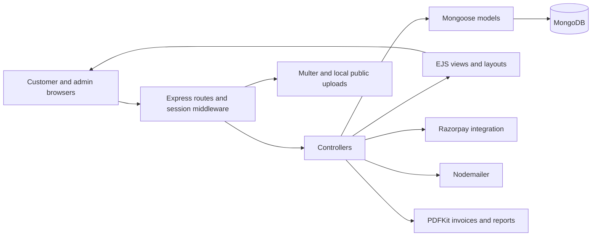

# ShopZen

A server-rendered e-commerce portfolio project built with Node.js, Express, EJS and MongoDB. It covers the customer journey from product discovery to orders, alongside product and store administration.

**Status:** historical portfolio implementation. Security remediation is required before real customers, personal data or payments are involved. The portfolio's demo URL returned 404 on 18 October 2026; no working deployment is advertised here.

## Implemented workflows

- Customer registration, email OTP verification, session login and password-reset flows.
- Product search and filtering, categories/subcategories, images, size/color attributes and inventory quantities.
- Cart quantities, wishlist, saved addresses and checkout.
- Orders, cancellation and return handling; wallet and coupon code paths.
- Razorpay order creation and signature-verification code, cash-on-delivery and wallet payment branches.
- PDF invoice generation with PDFKit.
- Admin dashboard, user blocking, products, categories, order status, coupons, banners and reports.

These are source-level capabilities, not claims of successful payment processing or audited commerce correctness. Product size/color fields are present; there is no claim of a separate, fully normalized variant inventory system.

## Architecture



This is a single Express application, not a React frontend or a microservice system. Route modules separate customer and administrator paths; controllers coordinate business workflows and Mongoose models hold persistence. EJS renders the interface on the server. Multer writes media to local public directories; Cloudinary is not an implemented dependency in this repository.

```text
index.js          Environment loading, MongoDB, sessions, views and server startup
routers/          Customer and admin routes
controllers/      Products, customers, profiles, cart, categories and administration
models/           Products, customers, orders, cart, wallet, coupons and related records
middleware/       Session checks, upload handlers and view helpers
config/           Session configuration
views/            EJS pages
layouts/          Shared page layouts
public/           Static assets and local uploads
```

## Setup for inspection

Use npm and a compatible Node.js runtime, a disposable MongoDB database, and your own test-mode integration credentials. No runtime version is pinned in the repository. Do not use production customer or payment data.

```bash
git clone --branch Project_ShopZen https://github.com/Aswnxyz/Project_ShopZen.git
cd Project_ShopZen
npm ci
```

Copy `.env.example` to `.env`. It documents the variables currently read by the application:

```dotenv
PORT=3000
MONGODB_CONNECT=mongodb://127.0.0.1:27017/shopzen_local
SHOPZEN_EMAIL=replace-with-development-mailbox
SHOPZEN_PASSWORD=replace-with-development-mail-credential
RAZORPAY_KEY_ID=replace-with-test-key-id
RAZORPAY_KEY_SECRET=replace-with-test-key-secret
```

The Razorpay client is constructed when the controller loads; integration configuration may be needed even when inspecting other pages. Email verification requires working development email credentials. No documented admin seed/bootstrap command exists, so admin access must be provisioned deliberately in a local database with the schema's expected password handling.

```bash
npm start
```

This runs `nodemon index.js`; visit `http://localhost:3000`. There is no frontend build step. Uploads rely on the local filesystem and its configured destinations.

## Security status and required fixes

1. **Rotate exposed signing material.** `config/config.js` contains a literal session secret. `controllers/cartController.js` also contains a literal HMAC key in payment verification. Treat exposed values as compromised; revoke/rotate the corresponding provider credentials and invalidate sessions as appropriate. No values are reproduced here.
2. **Use one environment-based source for each secret.** Replace the session literal with a validated `SESSION_SECRET` and make payment verification use the configured test/production Razorpay secret consistently. Merely adding `SESSION_SECRET` to `.env` does not fix the current code: it is not yet read.
3. **Enforce authorization on writes.** Several POST routes lack the explicit user/admin guard used on their GET counterparts. The admin view helper only sets `res.locals`; it does not reject unauthorized requests. Add guard and ownership tests before exposing writes.
4. **Recalculate checkout amounts server-side.** The order path calculates a cart aggregate but then uses totals and savings supplied in the request. Derive final prices, coupon eligibility and stock decisions from trusted records; make payment confirmation idempotent and bound to the authenticated user's stored order.
5. **Harden sessions and mutations.** The current session setup uses the default memory store without explicit secure-cookie policy. Add an appropriate persistent store, cookie/CSRF controls and safer HTTP methods for state-changing actions, with regression tests.

These are proposed targeted fixes. This documentation change does not alter authentication, payment behavior, deployments or Git history. Removing a literal from the latest source alone does not rotate it or erase historical exposure.

## Validation

`npm test` is currently a placeholder that exits with an error; there is no committed application test suite or CI test workflow. Do not report it as passing.

Non-executing syntax checks can be run with `node --check index.js` and against each controller/route file. They do not validate database or payment behavior. After the security fixes, prioritize tests for denied admin writes, cross-user ownership, price tampering, duplicate payment callbacks, stock races and invoice authorization.

For manual local review, verify product browsing, test-account login, cart/wishlist persistence and admin access controls. Exercise payment and email workflows only in deliberately configured test environments. No real payment was performed during this audit.

## Engineering trade-offs

Server-rendered pages keep the deployment model simple. Controllers currently mix validation, data access and business operations, which makes commerce invariants harder to test independently. Local uploads and in-memory sessions also limit multi-instance deployment. Improving those boundaries and adding regression tests would strengthen the project more than adding another payment or UI feature.
